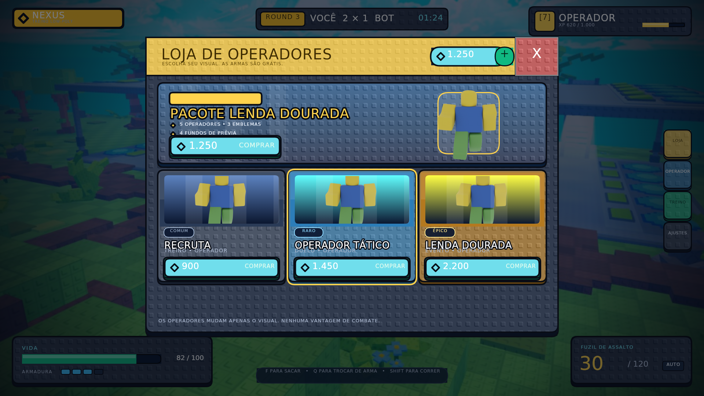

# Mockup: HUD do duelo + Loja de Operadores (NEXUS / WZ)

Construído com a skill [`ui-figma-roblox`](../.skills/ui-figma-roblox/SKILL.md) usando a arte
`assets/kek-ui-essentials/kek_stud.png` (studs em tile) e o render de operador do catálogo UI Resources.

## Arquivos

| Arquivo | O que é |
| --- | --- |
| `nexus-shop-hud.figma.js` | Script `use_figma` que desenha tudo em formas editáveis (HUD + modal) |
| `../preview/nexus-shop-hud.png` | Render do mesmo layout, gerado a partir da árvore de nós do script |
| `../scripts/test-figma-script.mjs` | Roda o script contra um stub da API do Figma (checa nomes, cores, textos vazios) |
| `../scripts/render-mockup.mjs` | Rasteriza o script em PNG, sem abrir o Figma |

## Como rodar no Figma

1. Abra o arquivo no Figma e **suba as imagens** com `upload_assets` (ou arraste e copie o hash do
   preenchimento). Os três arquivos estão no repo:

   | Uso no script | Caminho local |
   | --- | --- |
   | `HASH.studs` | `.skills/ui-figma-roblox/assets/kek-ui-essentials/kek_stud.png` |
   | `HASH.render` | `.skills/ui-figma-roblox/assets/ui-resources/files/Renders/815490552-download_url-4c39aa1c-a32d-45ec-ba57-98c838e25b84_Noob_Run.webp` |
   | `HASH.scene` (opcional) | `.skills/ui-figma-roblox/assets/ui-resources/files/Backgrounds/132278236-download_url-f6fd898f-26bc-4af2-ace0-7de650277f2d_G_b_Eb2WAAAJys_.webp` |

2. Cole os hashes em `HASH` no topo do script. Sem `studs` o script avisa e pula só a textura; sem
   `render` os cartões ficam com o gradiente.
3. Rode com a ferramenta `use_figma` (skill `figma:figma-use`). Sem `FRAME_ID`, ele cria um frame
   1920×1080 novo; com `FRAME_ID`, limpa os filhos daquele frame e reconstrói (reexecutável).
4. Ajuste textos, preços e cores em `CFG.copy` — tudo em pt-BR, no tom do jogo.

## O que está no layout

**HUD** (camada de trás, `01 · HUD de gameplay`):
marca NEXUS WZ + modo · placar do duelo (`ROUND 3 · VOCÊ 2 × 1 BOT · 01:24`) · perfil com nível e
barra de XP · vitais (vida 82/100 + armadura) · munição (30/120 · AUTO) · dica de teclas · ações
laterais (LOJA / OPERADOR / TREINO / AJUSTES).

**Loja** (camada da frente, `02 · Loja de Operadores`, painel 1120×800):
header dourado com título, subtítulo e moeda (+ top-up) · botão fechar vermelho · pacote destaque
com render, halo, bullets e botão de compra · 3 cartões (COMUM/RARO/ÉPICO → RECRUTA, OPERADOR
TÁTICO, LENDA DOURADA) com barra de preço verde · anel de foco dourado no cartão do meio · rodapé
deixando claro que operador é só visual.

## Receita de camadas (a mesma da skill)

- **Profundidade:** face + cópia deslocada (`depth`) preenchida com ×0.62 da cor (×0.45 nos botões).
- **Contorno:** 3–4 px *Outside* em `#090D16` em tudo.
- **Studs:** `kek_stud.png` em `TILE`, `scalingFactor 0.375` (24 px), blend `OVERLAY`, opacidade 0.2–0.5.
- **Bevel:** rim interno branco 3 px + lábio inferior escuro (~20 % da altura) com linha clara de 2 px.
- **Sheen:** faixas diagonais brancas a 8–10 % dentro de um frame com `clipsContent`, nunca por cima do texto.

## Paleta usada

`#090D16` página · `#101E3A` painel · `#FFD34D`/`#FFE78D` dourado · `#B45309` profundidade dourada ·
`#10B981`/`#065F46` verde de compra · `#3CB9F2`/`#70DEEC` ciano · `#F24848` fechar ·
`#E7EFFA` texto · `#AEBBD3` texto fraco. Igual ao `index.html`/`customizador.html`.

## Notas

- O render de personagem é do catálogo UI Resources (Noob Run, 512×512, fundo transparente). Tem
  direitos do criador original — é mockup, não asset de produção. Ver
  `.skills/ui-figma-roblox/ATTRIBUTION.md`.
- Não existe moeda no jogo hoje; o valor `1.250` é placeholder para o mockup. Se a economia for
  Robux, troque o losango pelo ícone em `assets/ui-resources/files/Icons/75-download_url2-RobuxIcon.svg`.
- A hero/preço usam um número só; ao ligar no jogo, puxe de `profile` (XP/nível) em `index.html`.
